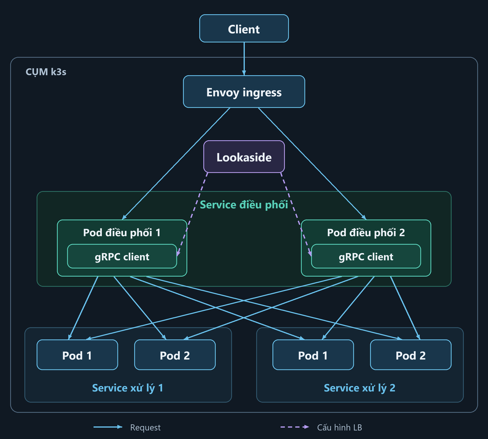

# Hệ thống cân bằng tải phân tán

Dự án tập trung vào hai tầng: **Envoy cân bằng request vào service điều phối** và **lookaside hỗ trợ cân bằng lời gọi từ service điều phối tới các service xử lý**.

## Kiến trúc triển khai trên k3s — kế hoạch

**Service điều phối** nhận request và tổng hợp kết quả từ **hai service xử lý mô phỏng**. Mỗi service có nhiều pod. Lookaside cấp endpoint và policy cho gRPC client trong từng pod điều phối; client chọn pod xử lý và gọi trực tiếp. Hai nhóm xử lý là hai service riêng, không phải hai replica của cùng service.

## Đã hoàn thành

- Envoy ingress cân bằng tải giữa các instance điều phối.
- Service điều phối và các service xử lý với nhiều instance, workload cấu hình được và kiểm soát deadline.
- Lookaside bằng gRPC xDS: cập nhật endpoint động, baseline Round Robin.
- Đăng ký service với Consul, health checking và HA cho control plane.
- Triển khai bằng Docker Compose trên ba VM; có công cụ tạo tải, đo đạc và thử lỗi/phục hồi.

Nền tảng đã được nghiệm thu trong phạm vi lab/cloud của đồ án. Kết quả và giới hạn được ghi trong [báo cáo nghiệm thu](docs/cloud-validation-report.md).

## Hướng tiếp theo

### Triển khai lên k3s

Chuyển ứng dụng từ Compose sang các workload do k3s quản lý, hỗ trợ định danh/địa chỉ pod động, readiness và rút pod khỏi routing khi dừng. Kiểm chứng toàn tuyến và tăng/giảm replica thủ công trước; HPA và RL tắt ở đợt baseline.

**Triển khai và đánh giá trực tiếp trên cùng cụm k3s.** Dữ liệu Compose cũ giữ làm tham khảo; mọi đối chứng mới chạy trên k3s với cùng điều kiện. Sau baseline mới đánh giá HPA, rồi RL.

### Đánh giá thực nghiệm

**Mục tiêu:** xác định hệ thống phân phối tải ra sao, chịu được mức tải nào và cập nhật/phục hồi thế nào khi backend thay đổi. Đợt này đánh giá nền tảng trước khi bật RL.

**So sánh:** static Round Robin và lookaside xDS Round Robin, cùng health checking, tài nguyên, workload và deadline. Đây là so sánh hai cách triển khai discovery/LB, chưa phải đối chứng thuật toán RL.

| Kịch bản | Cách thử | Nội dung đánh giá |
|---|---|---|
| Tải ổn định | Backend đồng đều; tăng tải từ thấp đến vượt ngưỡng xử lý | Phân bố request, goodput, latency và điểm bão hòa |
| Backend không đồng đều | Làm một pod xử lý chậm hơn hoặc giảm giới hạn xử lý của nó | Backend chậm có gây nghẽn, tăng latency/lỗi không |
| Tải đột biến | Tăng rồi hạ tốc độ gửi request | Mức suy giảm và thời gian trở lại ổn định |
| Thay đổi membership | Scale service xử lý 1: 2 → 4 → 2 pod, giữ các pod điều phối đang chạy | Thời gian nhận endpoint mới, ngừng chọn endpoint đã rút |
| Nhiều caller | Chạy 1, 2, 4 pod điều phối với cùng tổng tải gửi vào | Phân phối tải theo caller và trên toàn hệ thống |
| Backend lỗi/phục hồi | Xóa một pod xử lý trong lúc có traffic, theo dõi k3s tạo pod thay thế | Request lỗi, chuyển tải sang pod còn sống và phục hồi replica |
| Discovery gặp lỗi | Lần lượt thử mất CP, mất Consul leader/quorum | Caller cũ/mới, cập nhật endpoint và xử lý cấu hình hết hạn |
| Ingress gặp lỗi | Dừng một Envoy trong cấu hình ingress HA | Khả năng tiếp tục truy cập và thời gian gián đoạn đầu vào |

**Cách chạy dự kiến:** khảo sát trước điểm bão hòa; dùng cùng các mức RPS cho hai phương án. Mỗi lượt warmup 60 giây, đo 180 giây; lặp sáu lần/phương án và đảo thứ tự chạy. Tách từng thay đổi tải/sự cố, giữ trace cả thành công lẫn lỗi.

**Chỉ số và kết quả:** số request theo instance, goodput (request thành công/giây), p50/p95/p99, tỷ lệ lỗi/timeout, thời gian cập nhật endpoint và phục hồi. Báo riêng request toàn tuyến và RPC nội bộ; xuất đồ thị theo thời gian, bảng đối chứng và dữ liệu gốc. Không kết luận tốt hơn chỉ từ latency của các request thành công.

**Đánh giá và tối ưu:** mỗi kịch bản phải kết luận đạt/chưa đạt/chưa đủ bằng chứng theo tiêu chí, đồng thời so sánh với baseline. Nếu chưa đạt, người phụ trách phải tìm nguyên nhân, thử phương án tối ưu và đo lặp trước–sau; kiểm tra cả ảnh hưởng lên các kịch bản khác. Bàn giao phương án tốt nhất đã kiểm chứng trong giới hạn tài nguyên, ghi rõ phần chưa đạt và giới hạn còn lại. [Quy trình đánh giá và tối ưu](docs/controlled-experiments.md#danh-gia-toi-uu).

Kế hoạch chi tiết, tiêu chí đạt và phần công cụ cần bổ sung: [đợt đánh giá tiếp theo](docs/controlled-experiments.md#ke-hoach-tiep-theo).

**Phân công thực nghiệm:**

| Người phụ trách | Công việc | Bàn giao |
|---|---|---|
| **Lầu** | Chuẩn bị workload/Envoy trên k3s; E1, E2, E3, E5: hiệu năng/phân phối tải | Cấu hình workload, bộ phát tải/telemetry và đối chứng trước–sau tối ưu |
| **Đạt** | Chuẩn bị discovery/health trên k3s; E4, E6, E7, E8: cập nhật endpoint/phục hồi | Cấu hình discovery, runner sự kiện và đối chứng trước–sau tối ưu |

Hai người thống nhất cấu hình và định dạng dữ liệu, kiểm tra chéo kết quả rồi ghép báo cáo. [Đầu việc và tiêu chí bàn giao](docs/controlled-experiments.md#phan-cong).

### RL cho lookaside

Đã có nguyên mẫu Q-learning điều chỉnh trọng số qua xDS trong lab với một caller và hai instance của một service xử lý; chưa tích hợp vào cụm HA.

- Mở rộng telemetry và state/action cho nhiều caller, số backend thay đổi.
- Hoàn thiện reward; kiểm chứng hội tụ, độ ổn định và khả năng thích nghi.
- Đối chứng với Round Robin và policy theo quy tắc trước khi tích hợp.

Chưa đủ bằng chứng RL cải thiện ổn định so với baseline. Xem [thử nghiệm RL](docs/rl-lookaside-experiment.md).
