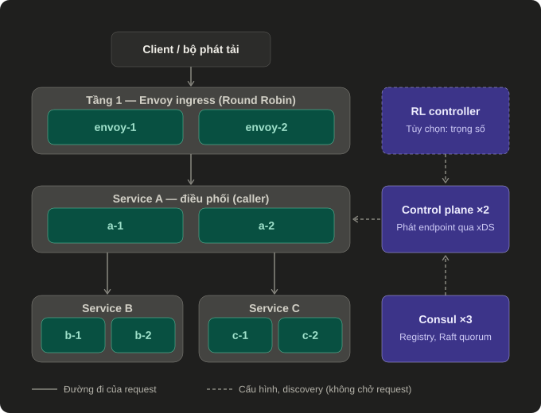
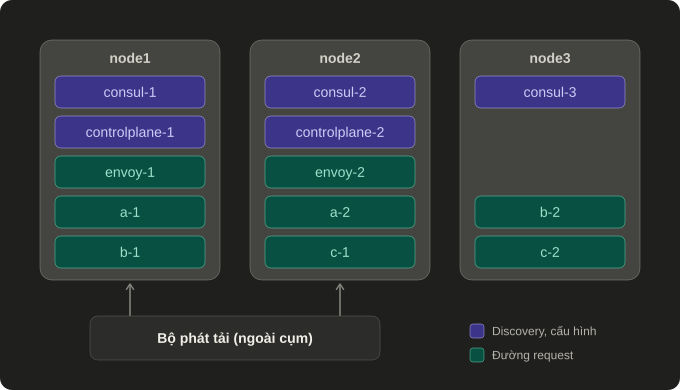

# Hệ thống cân bằng tải phân tán

Đồ án môn Hệ tính toán phân bố. Hệ thống cân bằng tải hai tầng: **Envoy cân bằng request vào service điều phối** và **lookaside (gRPC xDS) cân bằng lời gọi từ service điều phối tới các service xử lý**.

## Câu hỏi của đồ án

**Câu hỏi chính:** hệ thống cân bằng tải hai tầng này tiếp tục phục vụ thế nào khi từng thành phần phân tán bị lỗi — backend, máy chủ, control plane, registry, hoặc khi mạng bị phân mảnh?

**Câu hỏi mở rộng (RL):** một bộ điều khiển học được có thể điều chỉnh trọng số qua control plane nhân bản mà vẫn an toàn khi chính nó lỗi hoặc thiếu dữ liệu không?

## Kiến trúc

### Kiến trúc logic: request đi đâu, ai quyết định

- Có **hai lần cân bằng tải**: Envoy chọn a-1 hay a-2; sau đó chính A chọn instance B và C rồi gọi thẳng tới đó (mô hình lookaside).
- **Control plane không nằm trên đường đi của request.** Nó kiểm tra health, lấy danh sách instance từ Consul, và chỉ phát cập nhật khi có thay đổi. Control plane chết thì A vẫn dùng danh sách đã có.
- **RL là phần mở rộng tùy chọn**: nó chỉ đổi trọng số mà control plane phát ra, không tác động trực tiếp lên request.

### Bố trí trên ba node: một node chết thì mất gì

- **Hai bản của cùng một thành phần không bao giờ nằm chung node.** Chết một node bất kỳ thì thành phần nào cũng còn ít nhất một bản, và Consul còn 2/3, vẫn đủ quorum.
- **Node 1 gánh nặng nhất** (có cả Envoy lẫn control plane), nên "node 1 chết" là bài thử khó nhất.
- **Bộ phát tải nằm ngoài cụm** và giữ kết nối tới cả hai Envoy, nên khi một node chết nó vẫn tới được Envoy còn lại.

Cùng một bố trí dùng cho cả hai môi trường: ở đợt nghiệm thu cloud mỗi node là một VM; trong các thí nghiệm hiện tại mỗi node là một nhóm container trên cùng một máy ([`deploy/compose.lab.yaml`](deploy/compose.lab.yaml)). Việc chuyển sang workload do k3s quản lý **nằm ngoài phạm vi đồ án** (xem [Ngoài phạm vi](#ngoài-phạm-vi)).

## Khái niệm hệ phân tán được thể hiện

| Khái niệm | Thể hiện trong đồ án | Bằng chứng |
|---|---|---|
| Đồng thuận, quorum | Ba Consul voter (Raft); mất leader vẫn cập nhật endpoint | [HA lookaside](docs/lookaside-ha.md) |
| Nhất quán so với sẵn sàng | Mất quorum quá lease 15 giây thì fail closed, trả `UNAVAILABLE` thay vì dùng endpoint cũ | [Cải thiện HA](docs/ha-improvement.md) |
| Phát hiện lỗi | Control plane probe health trực tiếp, độc lập với catalog; hội tụ khi mất leader từ ~34 giây xuống 2–3 giây | [Cải thiện HA](docs/ha-improvement.md) |
| Nhân bản, chịu lỗi | Hai control plane, hai Envoy; tắt VM1 gián đoạn 1,75–3,95 giây | [Báo cáo nghiệm thu](docs/cloud-validation-report.md) |
| Khám phá dịch vụ | Registry + xDS; caller giữ cấu hình hợp lệ gần nhất | [Lookaside](docs/lookaside.md) |
| Deadline xuyên chuỗi gọi | Một budget cho hàng đợi, xử lý cục bộ và lời gọi phụ thuộc | [Điều tra deadline](docs/deadline-investigation.md) |

## Đã hoàn thành

- Envoy ingress cân bằng tải giữa các instance điều phối.
- Service điều phối và các service xử lý với nhiều instance, workload cấu hình được và kiểm soát deadline.
- Lookaside bằng gRPC xDS: cập nhật endpoint động, baseline Round Robin.
- Đăng ký service với Consul, health checking và HA cho control plane.
- Triển khai trên ba VM; có công cụ tạo tải, đo đạc và thử lỗi/phục hồi.
- Nguyên mẫu Q-learning điều chỉnh trọng số qua xDS, chạy trong lab với một caller và hai instance.

Kết quả và giới hạn: [báo cáo nghiệm thu](docs/cloud-validation-report.md), [thử nghiệm RL](docs/rl-lookaside-experiment.md).

## Kế hoạch một tuần (11–18/11/2026)

Các việc xếp theo thứ tự ưu tiên; dừng ở đâu cũng phải có kết quả báo cáo được. Phân công dưới đây là đề xuất, chờ cả nhóm xác nhận.

| # | Việc | Người phụ trách | Kết quả bàn giao |
|---|---|---|---|
| 1 | Lặp lại các bài thử lỗi: dừng backend, tắt VM1, mất control plane, mất Consul leader/quorum — mỗi bài 5 lần | Đạt | Bảng thời gian gián đoạn/phục hồi có min, median, max; trace gốc |
| 2 | Bài phân mảnh mạng: cô lập một Consul voter, rồi một control plane, trong lúc có traffic | Đạt | Hành vi của caller cũ và caller mới; kết luận fail closed hay tiếp tục phục vụ |
| 3 | Tải ổn định và backend không đồng đều: quét RPS đến bão hòa, 6 lượt mỗi phương án, phát tải từ Linux | Lầu | Điểm bão hòa, goodput, p95/p99; môi trường "một backend chậm" dùng chung cho RL |
| 4 | RL: đối chứng Round Robin, policy theo quy tắc và RL với ít nhất 5 seed, có đổi backend chậm giữa lượt | Khoa | Bảng so sánh có biến thiên giữa các seed; kết luận trung thực kể cả khi RL không hơn |
| 5 | RL trong cụm nhân bản: replica giữ khóa Consul ra quyết định, ghi trọng số vào Consul KV; replica còn lại đọc và phát cùng trọng số | Khoa | Hai control plane phát cùng trọng số; mất replica giữ khóa thì replica kia tiếp quản |
| 6 | Gom telemetry từ cả hai caller A thay vì chỉ A-1 | Khoa | Quyết định dựa trên dữ liệu toàn bộ caller |
| 7 | Dọn dẹp: sửa test phụ thuộc thời gian, điền hoặc xóa tài liệu rỗng, ghép báo cáo | Cả nhóm | Bộ test xanh, báo cáo cuối |

Môi trường chạy chính là lab ba node logic trên một máy (`deploy/compose.lab.yaml`); làm theo [hướng dẫn từng bước cho nhóm](docs/team-guide.md); tham số chi tiết ở [hướng dẫn chạy](docs/running.md). Cùng các lệnh đó chạy được trên ba VM cloud bằng tùy chọn `--env`, sau khi triển khai lại code mới lên VM.

### Tiêu chí cho phần RL

- RL không nằm trên đường xử lý request; khi telemetry cũ, sai hoặc thiếu mẫu thì quay về Round Robin.
- Trọng số mỗi endpoint giới hạn 30–70%; không chạy exploration trên cấu hình mặc định.
- Chỉ kết luận RL tốt hơn khi vượt policy theo quy tắc trên nhiều seed. Kết quả hiện tại chưa cho thấy điều đó.

### Cách đo và báo cáo

Chỉ số: số request theo instance, goodput, p50/p95/p99, tỷ lệ lỗi/timeout, thời gian cập nhật endpoint và thời gian phục hồi. Giữ trace cả thành công lẫn lỗi; không kết luận tốt hơn chỉ từ latency của request thành công. Phương pháp và định nghĩa chỉ số: [thực nghiệm đối chứng](docs/controlled-experiments.md). Phần kế hoạch k3s và ma trận E1–E8 trong tài liệu đó được thay bằng bảng trên.

## Ngoài phạm vi

Ghi vào mục hướng phát triển của báo cáo, không làm trong tuần này:

- Chuyển ứng dụng sang workload k3s, HPA.
- Observability đầy đủ (Prometheus, tracing) và AIOps.
- RL cho số backend bất kỳ.
- TLS/mTLS, nhiều zone/region.
