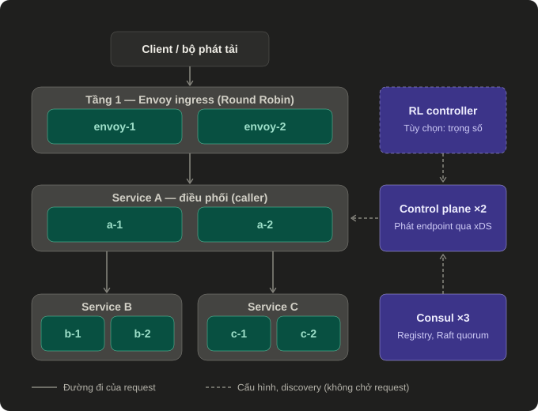
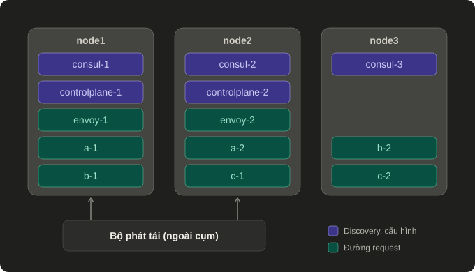

# Kiến trúc và mã nguồn

Trang này mô tả bố trí hệ thống, hành vi của từng thành phần và nơi tìm nó trong code.

## Bố trí trên ba node





| Node | Thành phần |
|---|---|
| node1 | consul-1, envoy-1, controlplane-1, a-1, b-1 |
| node2 | consul-2, envoy-2, controlplane-2, a-2, c-1, b-3 |
| node3 | consul-3, b-2, c-2 |

- **Hai bản của cùng một thành phần không nằm chung node.** Mất một node bất kỳ thì thành phần nào cũng còn ít nhất một bản, và Consul còn 2/3.
- **Node 1 gánh nặng nhất** (có cả Envoy lẫn control plane), nên "node 1 chết" là bài thử khó nhất.
- **Bộ phát tải nằm ngoài cụm**, đi qua LB của cloud tới cả hai Envoy.

Mỗi node là một VM trên cloud UIT-IoT, chạy bằng Docker Compose.

## Đường đi của một request

1. Bộ phát tải gửi request tới LB của cloud; LB chia cho envoy-1 và envoy-2.
2. Envoy chọn a-1 hoặc a-2 (Round Robin, hoặc Least Request tùy phương án).
3. A nhận request, kiểm tra hạn (deadline) và giới hạn đồng thời, rồi gọi B và C.
4. A tự chọn instance B và C từ danh sách endpoint đang có, gọi thẳng tới instance đó.
5. Mỗi request mang **một** quỹ thời gian cho hàng đợi, xử lý cục bộ và lời gọi phụ thuộc; phần còn lại được truyền xuống chặng sau.

## Đường điều khiển

| Thành phần | Việc nó làm | Khi nó hỏng |
|---|---|---|
| Consul (3 voter, Raft) | Giữ danh sách instance đã đăng ký | Mất 1: vẫn đủ quorum. Mất 2: không còn quorum |
| Control plane (2 bản) | Đọc danh sách từ Consul, tự probe health từng instance, phát endpoint cho A qua xDS | A giữ danh sách đã nhận và dùng bản control plane còn lại |
| Caller A | Nhận endpoint qua xDS, giữ cấu hình hợp lệ gần nhất | — |

Hai quy tắc quyết định hành vi khi lỗi:

- **Health và danh sách thành viên là hai nguồn riêng.** Control plane rút một instance ngay khi probe thất bại, không chờ Consul.
- **Fail closed.** Khi mất quorum quá thời hạn lease 15 giây, control plane phát danh sách rỗng và A trả `UNAVAILABLE`, thay vì tiếp tục dùng danh sách cũ có thể đã sai.

## Hai cách A biết endpoint

| Đường | A lấy endpoint từ | Chiến lược dùng được |
|---|---|---|
| xDS | Control plane, cập nhật động | Round Robin; trọng số do β cố định hoặc RL tính |
| static | Danh sách cố định trong cấu hình, có health watch | Round Robin; Least Request |

gRPC Python không có Least Request cho caller xDS, nên Least Request ở tầng trong chỉ chạy trên đường static. Hệ quả cho việc so sánh nằm ở [tra cứu](../2-cong-viec/tra-cuu.md#quy-tắc-so-sánh).

## Mã nguồn

### Service — `src/grpc_lb/`

| File | Trách nhiệm |
|---|---|
| `application.py` | Cấu hình, khởi động, tắt, giám sát task nền |
| `service_runtime.py` | gRPC server, health service, các client phụ thuộc |
| `processing.py` | Xử lý request: kiểm tra, giới hạn đồng thời, quỹ thời gian, gọi phụ thuộc |
| `dependencies.py` | Client tới service phụ thuộc: bản static và bản xDS |
| `registry.py` | Đăng ký và hủy đăng ký với Consul |
| `topology.py`, `endpoints.py` | Đọc sơ đồ service và chuẩn hóa địa chỉ |
| `workload.py` | Công việc mô phỏng của mỗi service |
| `rl_telemetry.py` | Caller ghi latency theo instance cho bộ điều khiển trọng số |

### Control plane — `src/grpc_lb/controlplane/`

| File | Trách nhiệm |
|---|---|
| `sources.py` | Đọc Consul, probe health, tạo snapshot thành viên |
| `resources.py` | Chuyển snapshot thành tài nguyên xDS (LDS, CDS, EDS) |
| `ads.py` | Máy chủ xDS: phát snapshot, xử lý ACK/NACK |
| `rl_controller.py`, `weighted.py` | Tính trọng số A → B từ telemetry; quay về Round Robin khi dữ liệu không đủ tin |
| `application.py`, `config.py` | Khởi động, tắt, cấu hình |

`rl.py` chứa công thức chia tải, bước lọc nhiễu và bandit, dùng chung cho control plane và lúc huấn luyện.

### Công cụ thí nghiệm — `scripts/`

| File | Trách nhiệm |
|---|---|
| `labenv.py`, `labenv_ssh.py` | Điều khiển cụm: dừng instance hoặc node, phân mảnh, độ trễ, đổi phương án, khóa cụm |
| `run_faults.py` | Chạy tình huống lỗi, tính gián đoạn và phục hồi, xuất báo cáo |
| `run_load.py` | Quét mức tải theo phương án và kịch bản, xuất báo cáo |
| `controlled_probe.py` | Bộ phát tải tốc độ cố định, ghi từng request |
| `multihost.py` | Sinh cấu hình ba node, đóng gói, triển khai lên VM |
| `train_shape_rl.py`, `compare_shape_rl.py` | Huấn luyện RL trong mô phỏng; so RL trên gRPC thật ở máy cục bộ |

Script của các giai đoạn trước nằm trong `scripts/legacy/` và kết quả cũ nằm trong `results/archive/`; cả hai không dùng trong đợt đo này. Sáu file M1 trong `src/grpc_lb/` (`server`, `client`, `loadgen`, `summarize`, `telemetry`, `contracts`) cũng không dùng trong đợt đo này.

## Kiểm tra mã

```powershell
.\.venv\Scripts\python.exe -m pip install -e ".[dev]"
.\.venv\Scripts\python.exe scripts/check_quality.py
```

`check_quality.py` chạy lint, kiểm tra định dạng và toàn bộ test.
