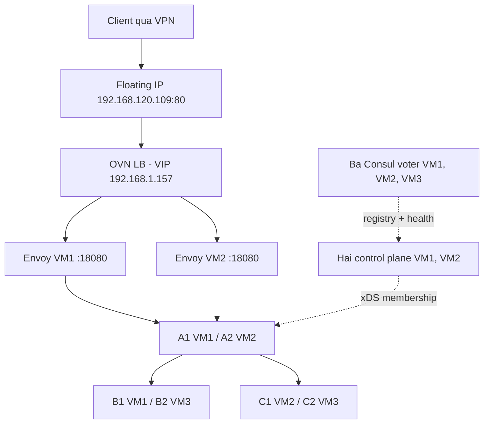

# Báo cáo nghiệm thu cloud — 28/10/2026

## Kết quả chính

Đã triển khai lại Python trên ba VM k3s theo lựa chọn của người dùng, bổ sung đầu vào độc lập VM1 và thực nghiệm thực tế. Phạm vi đạt là đồ án phân tán trong một availability zone; không phải chứng nhận production hoặc mọi loại sự cố cloud.

LB cloud dùng TCP và `SOURCE_IP_PORT`; Envoy cân bằng RPC tới A1/A2; A gọi trực tiếp B/C bằng static hoặc xDS Round Robin tùy mode đối chứng. Đây là hai lớp cân bằng khác nhau. SSH quản trị VM1 dùng Floating IP riêng `192.168.121.214`; client không còn phụ thuộc Floating IP của VM1.

## Đối chứng tải ổn định

Bộ xác nhận cuối chạy trực tiếp qua LB, light/heavy ở cùng 150 RPS, 20 giây/lượt, hai lần lặp mỗi mode, đảo thứ tự static→xDS rồi xDS→static. Cả tám lượt, tổng **24.000 RPC**, không có lỗi và không có generator drop. Bảng là median của hai lượt; không diễn giải median P99 thành P99 gộp.

| Workload | Mode | Goodput thực tế RPS | P95 OK ms | P99 OK ms | Lỗi RPC |
|---|---|---:|---:|---:|---:|
| light | static | 149.46 | 158.35 | 195.90 | 0% |
| light | xDS | 149.44 | 210.39 | 297.45 | 0% |
| heavy | static | 149.00 | 184.00 | 381.32 | 0% |
| heavy | xDS | 148.97 | 180.64 | 225.48 | 0% |

Ở đây goodput gần nhau; xDS có P99 cao hơn ở light và thấp hơn ở heavy. Không có bằng chứng xDS luôn nhanh hơn static. Mỗi cặp chỉ hai lượt và latency có nhiễu VPN/Windows, nên chưa đủ kết luận ý nghĩa thống kê. Mọi tiêu chí tải ổn định định trước đều đạt: lỗi ≤1%, goodput offered-window ≥98% tải đặt, P99 <3 giây và không generator drop.

Bằng chứng: [bảng tổng hợp cuối](../../results/k3s-controlled-final-report.md), [JSON có từng lần lặp](../../results/k3s-controlled-final-report.json), [metadata và JSONL gốc](../../results/k3s-controlled-final). Pilot 16 lượt, 32.000 RPC qua SSH tunnel được giữ riêng ở [bảng pilot](../../results/k3s-controlled-report.md); không trộn vào median cuối. Pilot có hoạt động kiểm tra kết nối song song trong lúc hoàn thiện hạ tầng nên dùng để khảo sát, không làm kết luận hiệu năng chính.

## Thử lỗi và phục hồi

Mỗi trace 20 RPS trong 120 giây, không retry RPC ở application. Gián đoạn tính từ RPC đầu lỗi tới đầu cửa sổ 5 giây toàn OK sau lỗi cuối, trước khi restore. Mốc dispatch/xác nhận lỗi được lưu riêng để không nhầm thời gian SSH/API với thời gian ứng dụng phục hồi.

| Tình huống | Kết quả | Gián đoạn RPC | Bằng chứng |
|---|---|---:|---|
| Dừng B2, static | 2.400/2.400 OK; 400 OK khi B2 được xác nhận dừng; chỉ B1 trả kết quả | Không ghi nhận | `backend-static.jsonl`, `.events.json` |
| Dừng B2, xDS | 2.400/2.400 OK; 399 OK khi B2 được xác nhận dừng; chỉ B1 trả kết quả | Không ghi nhận | `backend-xds.jsonl`, `.events.json` |
| VM1 SHUTOFF, kết nối thông thường | 2.382/2.400 OK, 18 UNAVAILABLE; 439 OK khi VM1 dừng | 1,75 giây | `vm1-xds.jsonl`, `.events.json` |
| VM1 SHUTOFF, buộc kết nối ban đầu qua Envoy VM1 | 2.322/2.400 OK, 78 UNAVAILABLE; 415 OK khi VM1 dừng; client mới cũng gọi được qua A2/B2 | **3,95 giây** | `vm1-primed-xds.jsonl`, `.events.json` |

Trong bài buộc kết nối qua VM1, lỗi là **3,25% trên toàn bộ 120 giây**, hoặc **78/571 = 13,66% trong khoảng dispatch stop→dispatch restore**. P99 chỉ trên OK là 145,23 ms; P99 toàn bộ RPC là 958,72 ms. Không mô tả kết quả này là zero downtime. Gián đoạn 3,95 giây đạt mục tiêu đồ án ≤30 giây; client giữ nguyên `192.168.120.109:80` và cùng channel gRPC tự reconnect.

Khi VM1 dừng, LB báo DEGRADED, member VM1 ERROR và member VM2 ONLINE; các instance trả kết quả chỉ là A2/B2/C1/C2. Cold client trong cùng khoảng SHUTOFF cũng nhận kết quả từ A2/B2. Sau đó đã start lại VM1. Hai bài VM không phải hai lần lặp đồng nhất: một bài thường và một bài prime; không dùng để suy ra phân bố RTO.

Bằng chứng đầy đủ: [bảng thử lỗi](../../results/k3s-fault-report.md), [JSON tổng hợp từ trace](../../results/k3s-fault-report.json), [trace gốc](../../results/k3s-faults), [quan sát Nova SHUTOFF](../../results/k3s-vm1-power-proof.json). Các kết quả này không chứng minh HA của hypervisor/router hạ tầng cloud.

## Nghiệm thu chức năng và lỗi đã vá

[Lượt nghiệm thu sau reboot qua Floating IP](../../results/k3s-post-reboot-acceptance.json) có `passed: true`, `operator_state: completed`, không có lỗi restore. Các tình huống gồm graph đủ sáu instance; 1.000 RPC baseline, 300 heavy và 5.000 stress đều OK; không nhận OK sau client timeout; NOT_SERVING và SERVING recovery; mất từng control plane với caller mới; mất Consul leader; mất quorum quá lease phải trả UNAVAILABLE; deadline 1 ms phải trả DEADLINE_EXCEEDED; graph phục hồi sau các lỗi. Thời gian hội tụ từng giai đoạn nằm trong JSON, không gọi đó là RTO của toàn VM.

Lần nghiệm thu đầu có reset SSH ở cleanup dù các bài chức năng đã đi hết; giữ nguyên [kết quả thất bại ban đầu](../../results/k3s-acceptance.json). Đã thêm retry chỉ cho cleanup idempotent và thao tác đặt mode idempotent, không retry tùy tiện lệnh gây lỗi. Lượt đối chứng pilot từng dừng trước hai lượt cuối do SSH reset; lưu `suite.interrupted.json` và tiếp tục đúng lượt thiếu sau khi kiểm tra tham số.

Sau reboot, công cụ xác minh còn phát hiện archive ở `/tmp` bị dọn. Đã vá deployment để lưu `/opt/loadbalance/release.tar.gz` và đọc checksum từ đường dẫn bền vững này. Giữ [lần thất bại do file tạm](../../results/k3s-final-acceptance.json), rồi triển khai lại và chạy lượt nghiệm thu sau reboot thành công. Không sửa report thất bại thành pass.

## Tái lập, giả thuyết và giới hạn

[Protocol thực nghiệm và tiêu chí đạt](controlled-experiments.md) mô tả H1/H2/H3, biến kiểm soát, định nghĩa latency/throughput/error/recovery và lệnh chạy lại. [Hướng dẫn triển khai](cloud-rebuild-2026-10-28.md) nêu inventory, cổng, SSH, DNS, image transfer và provenance. H1 đạt trong hai tình huống VM1 đã thử; H2 đạt với lỗi backend/control plane/registry đã thử; H3 đạt giới hạn tải và deadline nhưng không xác nhận lợi thế hiệu năng phổ quát của lookaside.

Ba VM cùng az-03, chưa chứng minh khác hypervisor; cấu hình CPU/RAM khác nhau và chạy chung k3s. Client qua VPN; chỉ hai lần lặp mỗi cặp tải ổn định, một trace mỗi tình huống lỗi. Probe schema 2 trong bộ xác nhận ngăn phát request sớm, nhưng vẫn có scheduling lag Windows được ghi trong JSON. Static có health Watch hợp lệ; lợi thế cập nhật membership tự động không được chứng minh bằng một baseline cố tình thiếu health checking. Chưa thử partition mọi chiều, đồng thời mất hai VM, sự cố router/hypervisor, multi-region, TLS/mTLS hoặc AIOps tự động. Thử tắt VM1 cũng tạm dừng k3s control plane dùng chung máy.

Trạng thái bàn giao cuối và việc thu hồi credential được ghi trong `results/k3s-final-audit.json`. Chỉ dùng endpoint để demo sau khi kiểm tra audit: ba VM ACTIVE, 13 container chạy, ba Consul voter, LB ONLINE, graph đủ instance và ba Kubernetes node Ready.
