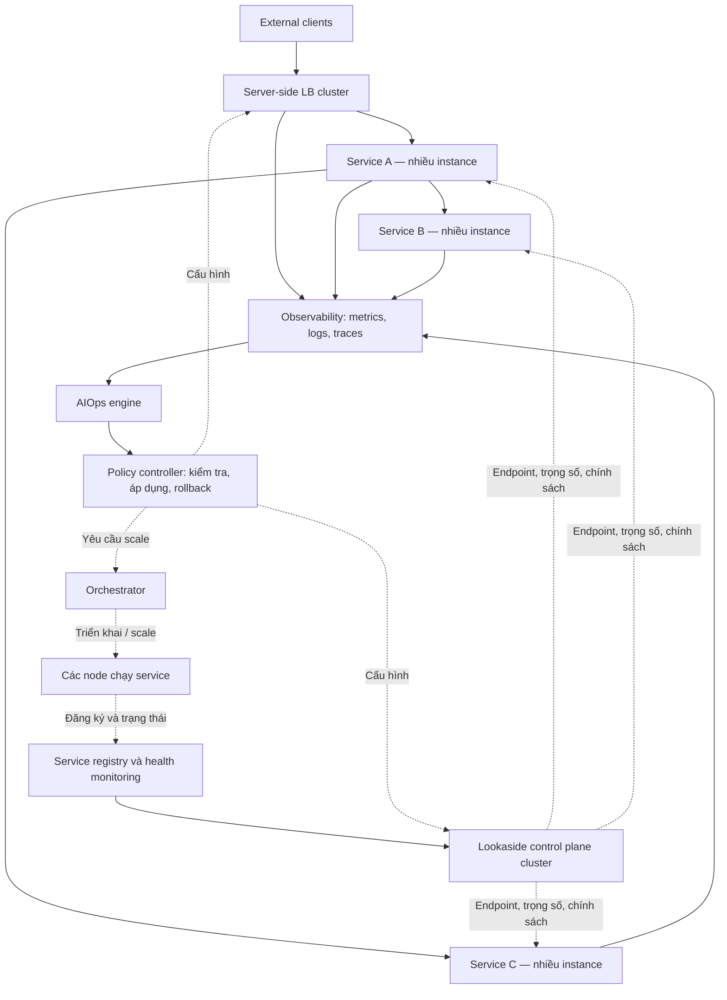

# Định hướng dự án: Hệ thống cân bằng tải phân tán kết hợp AIOps

Ngày thống nhất định hướng: 25/10/2026.

## 1. Mục tiêu và phạm vi

Xây dựng hệ thống phục vụ ứng dụng microservices quy mô lớn, có nhiều service, mỗi service có nhiều instance chạy trên các node khác nhau. Hệ thống kết hợp:

- **Server-side load balancing** cho traffic từ client bên ngoài vào hệ thống.
- **Lookaside load balancing** cho các lời gọi giữa service nội bộ.
- **AIOps** sử dụng dữ liệu vận hành để phát hiện bất thường, dự báo quá tải và hỗ trợ điều chỉnh phân phối tải hoặc quy mô triển khai.

Hiện dự án chưa xác định nghiệp vụ cụ thể. Lớp xử lý dùng service workload tổng quát với topology cấu hình được để thí nghiệm; tên A/B/C không gắn với chức năng thương mại.

Đây là kiến trúc đích của dự án. Quy mô thí nghiệm có thể nhỏ hơn để phù hợp tài nguyên, nhưng phải giữ được luồng giao tiếp giữa nhiều service và khả năng mở rộng nhiều node. Không giới hạn kiến trúc ở mô hình một client gọi nhiều replica của duy nhất một service.

## 2. Các khái niệm cần phân biệt

| Khái niệm | Ý nghĩa |
|---|---|
| Service | Chức năng logic, ví dụ Service A, Service B, Service C; tên tùy cấu hình |
| Instance / replica | Một bản chạy của service |
| Node / server | Máy vật lý hoặc máy ảo chạy các instance |
| External client | Web, mobile hoặc ứng dụng bên ngoài |
| Internal caller | Service đang gọi service khác; đóng vai trò client của service đích |

Một node có thể chạy nhiều service. Một service có thể có nhiều instance trên nhiều node.

Topology và cân bằng tải có trách nhiệm riêng: cấu hình xác định Service A cần gọi Service B; bộ cân bằng tải quyết định gửi lời gọi đó đến instance Service B nào. Trong ứng dụng thực, quan hệ gọi còn phụ thuộc nghiệp vụ của ứng dụng.

## 3. Kiến trúc tổng thể



Các mũi tên từ service đến observability biểu diễn luồng telemetry, không phải đường chuyển tiếp request nghiệp vụ. Cấu hình gửi tới một service áp dụng cho các lời gọi đi của service đó, theo từng service đích.

### 3.1. Server-side LB ở cửa vào

External client chỉ cần biết địa chỉ công khai chung. Cụm LB tiếp nhận kết nối, xử lý TLS và phân phối request đến các instance khỏe mạnh của service đầu vào. Routing theo API và các chức năng gateway được bổ sung khi cần.

LB phải có phương án sẵn sàng cao: nhiều replica kèm cơ chế định tuyến/failover ở phía trước, hoặc dịch vụ LB managed. Chạy hai tiến trình LB đơn thuần chưa đủ loại bỏ điểm lỗi ở địa chỉ truy cập chung.

### 3.2. Lookaside trong nội bộ

Lookaside control plane cung cấp danh sách endpoint, trọng số và chính sách cho caller. Thư viện LB trong caller giữ cấu hình cục bộ, chọn instance và gọi trực tiếp service đích.

```text
Lookaside control plane ── cấu hình ──> Service A instance
                                           │
                                           ├── RPC trực tiếp ──> Service B-1
                                           └── RPC trực tiếp ──> Service B-2
```

Control plane không chuyển tiếp request nghiệp vụ và không bị hỏi trước mỗi request. Nó cập nhật cấu hình khi topology hoặc chính sách thay đổi. xDS là hướng tích hợp dự kiến; giao thức cụ thể cần được xác nhận theo thư viện và ngôn ngữ triển khai.

Việc chọn instance cho từng RPC vẫn diễn ra tại caller. Tập trung quản lý chính sách không đồng nghĩa tập trung toàn bộ thao tác chọn backend.

### 3.3. Registry và health monitoring

Theo dõi service, instance ID, endpoint, phiên bản, node/zone và trạng thái sẵn sàng. Nhận đăng ký, heartbeat hoặc dữ liệu từ nền tảng triển khai; cập nhật endpoint đủ điều kiện nhận traffic.

Phân biệt instance còn sống, sẵn sàng nhận request và đang quá tải. Caller có thể phát hiện lỗi cục bộ nhanh hơn control plane và tạm tránh endpoint lỗi theo chính sách.

### 3.4. Observability và AIOps

Thu thập metrics, logs và distributed traces; truyền trace ID xuyên suốt chuỗi gọi để liên kết yêu cầu bên ngoài với các RPC nội bộ.

| Thành phần | Trách nhiệm |
|---|---|
| Observability | Thu thập và tổng hợp dữ liệu vận hành |
| AIOps engine | Phát hiện bất thường, dự báo tải, đưa ra đề xuất kèm độ tin cậy |
| Policy controller | Kiểm tra ràng buộc, áp dụng thay đổi, ghi audit và rollback |
| Orchestrator | Thực hiện scale, triển khai và thay thế instance |

AI không nằm trên đường xử lý từng request. Khi AI lỗi hoặc không đủ độ tin cậy, các thuật toán LB cơ bản vẫn hoạt động.

## 4. Vì sao cần cân bằng tải giữa các service?

Server-side LB ở cửa vào chỉ cân bằng chặng mà nó tiếp nhận. Sau khi request đến Service A, các lời gọi Service A → Service B và Service A → Service C cần được phân phối độc lập.

Nếu tất cả Service A instance gọi Service B-1, Service B-1 có thể quá tải trong khi Service B-2 nhàn rỗi. Cân bằng tải nội bộ giúp tận dụng các replica, tránh instance lỗi và thích ứng khi thêm/bớt instance hoặc triển khai phiên bản mới.

Lookaside là lựa chọn kiến trúc để quản lý điều phối tập trung trong khi giữ đường gọi trực tiếp. Nó không phải điều kiện bắt buộc của microservices; dự án chọn mô hình này để nghiên cứu cân bằng tải phân tán và tích hợp AIOps.

## 5. Luồng xử lý điển hình

1. Client gửi workload nhẹ hoặc nặng đến server-side LB.
2. LB chọn Service A-2 đang sẵn sàng.
3. Service A-2 dùng cấu hình lookaside đã cache để chọn Service B-1 và Service C-2 theo topology.
4. Các service xử lý và trả kết quả; telemetry ghi nhận các chặng gọi.
5. AIOps phân tích dữ liệu theo cửa sổ thời gian, ví dụ phát hiện Service B-2 có latency và hàng đợi tăng bất thường.
6. Policy controller đánh giá đề xuất giảm trọng số Service B-2 hoặc tăng số Service B instance.
7. Control plane phát cấu hình mới; orchestrator thực hiện scale nếu được phép.
8. Hệ thống đo kết quả sau thay đổi, giữ cấu hình hoặc rollback.

A/B/C là các service workload tổng quát, không mang nghiệp vụ cố định. Service ID, topology, cách gọi tuần tự/song song và đặc tính workload được cấu hình bằng JSON. Dự án tập trung vào cân bằng tải và AIOps, chưa đặt ra nghiệp vụ thương mại.

## 6. Chính sách cân bằng tải và chịu lỗi

- Dùng Round Robin làm baseline; so sánh với Least Request hiện có trước khi thêm cơ chế thích nghi.
- Bộ đếm in-flight tại một caller chỉ phản ánh request của caller đó, không phải tổng tải toàn hệ thống. Khi cần tải toàn cục phải dùng telemetry tổng hợp và tính đến độ trễ dữ liệu.
- Thêm weighted routing khi cần biểu diễn khác biệt năng lực hoặc điều chỉnh traffic.
- Đặt deadline, giới hạn concurrency và hàng đợi; retry có giới hạn, backoff và jitter. Chỉ tự động retry thao tác an toàn hoặc có cơ chế idempotency.
- Khi mất control plane, dùng cấu hình hợp lệ gần nhất kết hợp health cục bộ. Cần quy định thời hạn dữ liệu, cách khởi động khi chưa có cấu hình và hành vi khi không còn backend khả dụng.
- Control plane có nhiều replica; cần chọn nguồn trạng thái và cơ chế đồng bộ/version cấu hình. Chưa mặc định chọn Raft hoặc một thuật toán consensus cụ thể.
- Khi triển khai nhiều zone/region, ưu tiên locality và chỉ failover khi nơi nhận còn năng lực phục vụ.
- Bảo vệ API cấu hình và telemetry bằng xác thực, phân quyền; backend nội bộ không cần công khai cho external client.

## 7. Phạm vi AIOps

### Đầu vào

Request rate, throughput thành công, latency p50/p95/p99, error/timeout rate, in-flight, độ dài hàng đợi, CPU/RAM, health và phân bố traffic theo service/instance/node. Phân tích phải xét độ mới, độ đầy đủ và cửa sổ tổng hợp của dữ liệu.

### Bài toán ban đầu

Phát hiện instance suy giảm hiệu năng hoặc dự báo quá tải trong một khoảng thời gian xác định. So sánh mô hình với baseline theo ngưỡng để chứng minh giá trị của AI; chưa chốt mô hình học máy cụ thể.

### Hành động và kiểm soát

Ban đầu chạy chế độ quan sát/đề xuất. Khi đạt tiêu chí đánh giá mới tự động điều chỉnh trọng số trong phạm vi giới hạn. Scale là bước tiếp theo; thao tác phá hủy hoặc thay đổi lớn cần cơ chế kiểm soát riêng.

Giới hạn gồm mức thay đổi mỗi lần, trọng số tối thiểu/tối đa, cooldown, số instance tối thiểu/tối đa, điều kiện dừng và rollback. Tránh để vòng điều chỉnh trọng số và autoscaling liên tục phản ứng ngược nhau.

Mỗi hành động phải lưu dữ liệu đầu vào, phiên bản mô hình/chính sách, lý do, cấu hình trước/sau và kết quả. AI phải tạo thành vòng quan sát → phân tích → hành động → đánh giá; chatbot hay dashboard riêng lẻ không đủ cho mục tiêu AIOps của dự án.

## 8. Hiện trạng và lộ trình

Cập nhật lớp xử lý: đã có ProcessingService tổng quát với topology cấu hình được (mẫu A gọi B và C), mỗi service hai instance, health và deadline. Hỗ trợ dependency nhiều tầng, gọi tuần tự/song song, workload nhẹ/nặng và lỗi mô phỏng. Có launcher 6 process để kiểm chứng không cần Docker và stack Compose nối Envoy. Xem [triển khai microservices](microservices.md). Đã bổ sung [lookaside native gRPC xDS](lookaside.md), dùng control plane Python và protobuf xDS chính thức cấp membership động, và [registry/health/HA](lookaside-ha.md) dùng Consul ba server cùng hai replica xDS. AIOps và nghiệm thu đa host vẫn còn trong lộ trình.

README và M1.md mô tả nền tảng hiện có: Python `grpc.aio`, unary RPC Execute, nhiều backend, Round Robin/Least Request, health checking, tạo tải và telemetry JSONL. Đây là nền móng cho data plane nội bộ; chưa đại diện cho toàn bộ kiến trúc đích. Trạng thái nghiệm thu chi tiết vẫn theo M1.md.

| Giai đoạn đề xuất | Kết quả cần đạt |
|---|---|
| Củng cố M1 | Có baseline tái lập được cho policy, hiệu năng và phục hồi |
| Nhiều service + ingress | Có external client → server-side LB → chuỗi gọi ít nhất hai service; mỗi service có nhiều instance |
| Lookaside động | Registry/health, API cấu hình, caller nhận cập nhật, cache và xử lý mất control plane |
| Phân tán nhiều node | Triển khai trên nhiều máy/VM, kiểm tra lỗi node, replica LB/control plane và topology thay đổi |
| Observability | Metrics và traces đủ liên kết request xuyên service, dashboard và dữ liệu thí nghiệm |
| AIOps đề xuất | Mô hình phát hiện/dự báo được đánh giá với baseline; chưa tự tác động traffic |
| AIOps vòng kín | Điều chỉnh có giới hạn, đo hiệu quả và rollback; nghiên cứu scale khi đủ điều kiện |

Lộ trình này chưa thay thế phân công M1 và chưa ấn định tên các milestone tiếp theo. RL và Digital Twin là hướng nghiên cứu tùy chọn, không phải điều kiện bắt buộc của kiến trúc.

## 9. Đánh giá và kịch bản thí nghiệm

So sánh các cấu hình trên cùng topology, workload và giới hạn tài nguyên: Round Robin, Least Request, lookaside với chính sách cơ bản, và lookaside có AIOps. Tách lợi ích thuật toán khỏi lợi ích do tăng thêm tài nguyên.

Kịch bản cần có: tải ổn định, tăng đột biến, instance chậm, instance/node chết, thêm/bớt replica, mất một replica control plane, mất kết nối control plane, dữ liệu telemetry cũ và AI không hoạt động.

Đo latency p95/p99, throughput thành công, error rate, mức độ quá tải, thời gian phát hiện/phục hồi, độ trễ áp dụng cấu hình và overhead telemetry/control plane. Với AI, đo thêm false positive/false negative hoặc sai số dự báo, số lần đổi chính sách, dao động và hiệu quả sau hành động.

Chốt ngưỡng nghiệm thu định lượng sau khi có baseline, không mặc định AI luôn tốt hơn. Chạy lặp và báo cáo biến thiên. Container trên một máy phục vụ phát triển; thí nghiệm lỗi máy cần nhiều máy hoặc VM độc lập.

## 10. Tham khảo kiến trúc

- [Google Cloud Service Mesh — load balancing](https://docs.cloud.google.com/service-mesh/v1.25/docs/service-routing/load-balancing): external LB kết hợp cân bằng tải service nội bộ.
- [Google Cloud — proxyless gRPC](https://docs.cloud.google.com/service-mesh/docs/service-routing/proxyless-overview): control plane cấp cấu hình cho gRPC caller.
- [Thiết kế load balancing của gRPC](https://github.com/grpc/grpc/blob/master/doc/load-balancing.md): chọn backend theo RPC và mô hình grpclb.
- [LINE MAN/Wongnai xDS](https://github.com/wongnai/xds): ví dụ xDS phân phối Kubernetes endpoints cho gRPC client.

Các nguồn hỗ trợ lựa chọn kiến trúc; chính sách AIOps và lộ trình trên là định hướng riêng của dự án, không phải một thiết kế do Google quy định.

## Cập nhật nền tảng — 26/10/2026

Đã khoanh vùng/tái hiện vấn đề deadline độc lập với LB, nâng đồng bộ gRPC lên 1.84.0, có 81 test và bài nghiệm thu toàn tuyến đạt deadline trong phạm vi thử nghiệm. Xem [bằng chứng](deadline-investigation.md). Kết quả deadline này độc lập với [bước triển khai lookaside/xDS tiếp theo](lookaside.md), có bài nghiệm thu riêng. AIOps chưa được triển khai.
